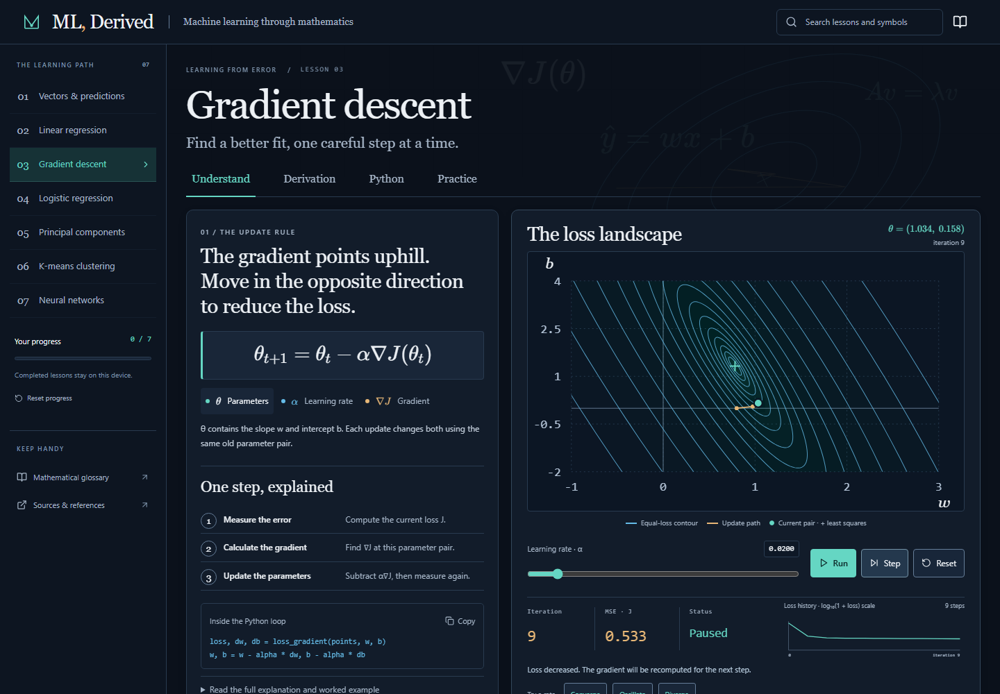

# ML, Derived

ML, Derived is an interactive guide to the mathematics behind machine learning. Connect an equation to a worked calculation, an SVG experiment, and a Python implementation.

[Website](https://www.mlderived.site)



## Explore

Each lesson includes intuition, linked prerequisites, symbol definitions, a derivation, a numerical example, an experiment, Python code, limitations, and three questions with feedback.

| Lesson                       | Experiment                                                                                             |
| ---------------------------- | ------------------------------------------------------------------------------------------------------ |
| Vectors and dot products     | Drag feature and weight vectors, or use sliders and arrow keys; inspect contributions and direction.   |
| Linear regression            | Edit observations, fit a line, inspect squared errors, and try an optional MSE challenge.              |
| Gradient descent             | Step, run, pause, and reset optimization; compare convergence, oscillation, and divergence.            |
| Logistic regression          | Change weights and thresholds; inspect probabilities, a decision boundary, and classification metrics. |
| Principal component analysis | Rotate a projection axis; compare variance, reconstruction error, and standardization.                 |
| K-means                      | Alternate assignments and centroid updates; compare deterministic starting points.                     |
| A tiny neural network        | Follow an XOR network's forward pass, inspect gradients, and train in bounded sessions.                |

Select a mathematical symbol to read its definition. In gradient descent, focusing the learning-rate control highlights α in the update rule. The regression challenge checks the actual MSE on the example dataset and can be restarted or left at any time.

Each experiment suggests a concrete change and explains what to compare in the equation, plot, and numerical results. PCA labels shared custom clouds separately from the built-in examples.

Search covers lessons, concepts, and symbols. Completion is saved in the current browser after an explicit action. Share links preserve validated experiment parameters and datasets.

All calculations run locally in the browser. No account, backend, API key, or environment file is needed. Python examples are displayed and downloadable; run them separately with Python.

## Install and run

Use **Node.js 24 LTS and npm**. CI uses Node 24 and Python 3.12. Python is needed only for the companion examples and their checks.

```sh
npm ci
npm run dev
```

Open **http://127.0.0.1:5173**, or the address Vite prints if that port is occupied.

## Check and build

Install Chromium once for browser tests:

```sh
npx playwright install chromium
```

On Linux, use `npx playwright install --with-deps chromium` to install its system dependencies too.

| Command                                | Purpose                                                                                    |
| -------------------------------------- | ------------------------------------------------------------------------------------------ |
| `npm run format:check`                 | Check source and documentation formatting.                                                 |
| `npm run typecheck`                    | Check TypeScript, including unused variables and imports.                                  |
| `npm test`                             | Check numerical engines, gradients, URL validation, and existing progress records.         |
| `python -I -S scripts/check_python.py` | Execute all seven Python examples and check their calculations without optional libraries. |
| `npm run test:e2e`                     | Check Chromium workflows against the development server.                                   |
| `npm run test:e2e:production`          | Build and check the compiled application in Chromium.                                      |
| `npm run test:pages`                   | Build under a test subpath and check static-hosting links and assets.                      |
| `npm run build`                        | Type-check and generate `dist/`.                                                           |
| `npm run preview`                      | Serve an existing build at **http://127.0.0.1:4173**.                                      |

`npm run format` applies formatting; `npm run test:watch` watches numerical tests. There is no separate lint configuration. `npm run screenshot` captures gradient descent after nine actual steps at desktop, tablet, and mobile widths, using a running development server.

[CI](.github/workflows/checks.yml) runs the checks without deploying. [Deployment instructions](docs/DEPLOYMENT.md) explain static hosting, base paths, and the manually triggered GitHub Pages workflow.

## Source layout

| Directory                                 | Responsibility                                                                                                          |
| ----------------------------------------- | ----------------------------------------------------------------------------------------------------------------------- |
| [src/math](src/math/)                     | Pure numerical engines, deterministic data, parameter validation, and numerical tests.                                  |
| [src/content](src/content/)               | Lessons, derivations, worked examples, quizzes, glossary, and references.                                               |
| [src/experiments](src/experiments/)       | Interactive controls, challenges, and bounded training sessions. The gradient training hook owns its timer and history. |
| [src/visualizations](src/visualizations/) | SVG plots and loss traces using engine outputs, including a separate gradient landscape and draggable vector handles.   |
| [src/components](src/components/)         | Shared controls, lesson tabs, equations, symbol explanations, code downloads, quizzes, search, and static scenery.      |
| [src/python](src/python/)                 | The same Python files displayed and downloaded by the app.                                                              |
| [tests](tests/)                           | Browser workflows, accessibility checks, and responsive layout checks.                                                  |

[src/styles/](src/styles/) holds shared design tokens and experiment styling. [src/lib/progress.ts](src/lib/progress.ts) handles completion records using the existing storage key and format. The shell in [App.tsx](src/App.tsx) owns lesson routing and shared experiment parameters. Section links only scroll; restoring a different URL resets transient experiment history to match its parameters.

React and TypeScript provide the interface. Vite builds the static site, Tailwind supplies the CSS foundation, and KaTeX renders equations with bundled fonts. Calculations keep double precision; only displayed values are rounded. See [mathematical conventions](docs/MATHEMATICS.md) and [interface design](docs/DESIGN.md).

## Contribute

For a correction, identify the lesson, equation or interaction, and an independently checkable result or primary reference. Update explanations, engine behavior, Python examples, and tests together when a calculation changes.

The lesson schema and registration are in [src/content/lessons.ts](src/content/lessons.ts). A new lesson also needs validated defaults in [parameters.ts](src/math/parameters.ts), an experiment registered in [App.tsx](src/App.tsx), a Python companion, and browser coverage. [CONTRIBUTING.md](CONTRIBUTING.md) describes the conventions and review checks.

## Limitations

The curriculum is introductory and in English. Small deterministic datasets illustrate methods; results are not benchmarks. Optional NumPy, scikit-learn, and PyTorch comparisons are outside the standard-library checks.

Challenge completion lasts for the current lesson visit and is separate from lesson completion. Starting the regression challenge replaces its points with the documented example dataset.

Progress stays in one browser. Shared links contain parameters and points, not optimization history; K-means restarts from its selected initialization. Data size, parameter ranges, and training sessions are bounded. A numerical safety stop does not establish convergence.

Wide equations and tables scroll within their own regions. Clipboard and downloads depend on browser permissions and support. Automated browser checks target Chromium; Firefox, WebKit, physical touch devices, and screen-reader sessions are not covered.

## References and license

The in-app references page links primary course materials and official library documentation. Sources and dependency licenses are recorded in [THIRD_PARTY_NOTICES.md](THIRD_PARTY_NOTICES.md).

ML, Derived is licensed under the [MIT License](LICENSE), copyright © 2026 Mohammed Largou. Third-party dependencies retain their own licenses and notices.
